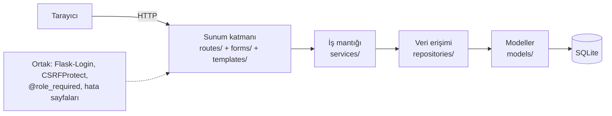

# P11 — Vize Kısa İlerleme Raporu

| | |
|---|---|
| **Proje** | Tarladan Sofraya — Çiftçi Doğrudan Satış ve Fiyat Takip Platformu |
| **Ders** | Bilgisayar Programcılığı, Bingöl Üniversitesi |
| **Sürüm** | `v0.8.0-vize` (Git etiketi) |
| **Tarih** | 19.10.2026 |
| **Teknoloji** | Python, Flask 3, SQLAlchemy, SQLite, Flask-Login, Flask-WTF, Jinja2, Bootstrap 5, pytest |

## 1. Özet

Platformun çekirdeği tamamlandı: kullanıcı kaydından siparişin teslim edilmesine kadar olan akış uçtan uca çalışıyor
ve **95 otomatik testle** doğrulanıyor. Harici API'ler, yapay zekâ bileşeni, değerlendirme ve raporlama vize sonrası
haftalara planlandı; bunların veri tabanı tabloları (payments, market_prices, price_predictions, reviews) şimdiden hazır.

## 2. Haftalara göre durum

| Hafta | Modül | Durum | Kanıt |
|---|---|---|---|
| 3-4 | Katmanlı mimari, veri tabanı (14 tablo) | ✅ Tamam | `test_models.py` |
| 5 | Kayıt, giriş, parola hashleme (scrypt), rol tabanlı erişim | ✅ Tamam | `test_auth.py` (13) |
| 6 | Üretici profili, ürün CRUD, görsel yükleme, kategoriler | ✅ Tamam | `test_producer.py` (19), `test_categories.py` (9) |
| 7 | İlan, sepet, sipariş, transaction, durum yönetimi | ✅ Tamam | `test_listings.py` (14), `test_cart.py` (11), `test_orders.py` (12) |
| 8 | Entegrasyon, düzeltmeler, demo verisi | ✅ Tamam | `test_integration.py` (14) |
| 9 | Harici fiyat ve ödeme API'si | ⏳ Planlandı | Tablolar ve ayarlar hazır |
| 10 | Yapay zekâ: trend tahmini, satış zamanı önerisi | ⏳ Planlandı | `price_predictions` tablosu hazır |
| 11-12 | Değerlendirme, itibar, satış raporları | ⏳ Planlandı | `reviews` tablosu, itibar alanları hazır |
| 13-15 | Test kapsamı, dokümantasyon, sunum | 🔄 Sürüyor | 95 test, README |

## 3. Sayılarla ara sürüm

| Ölçü | Değer |
|---|---|
| Otomatik test | 95 (birim + entegrasyon) |
| Veri tabanı tablosu | 14 |
| Blueprint / rota | 7 / 34 |
| Servis modülü | 6 (auth, producer, category, listing, cart, order) |
| Python kodu (app/) | ~3.150 satır |
| Jinja2 şablonu | ~1.600 satır |
| Test kodu | ~1.500 satır |

## 4. Mimari

Kural: Rota hiçbir zaman doğrudan sorgu yazmaz, servisi çağırır; servis veri tabanına yalnızca repository üzerinden ulaşır.

## 5. Uçtan uca akış (vize kapsamı)

1. **Kayıt / giriş** → `users`, `roles` (üretici kaydında `producer_profiles`, müşteri kaydında `carts` otomatik açılır)
2. **Üretici profili ve ürün** → `producer_profiles`, `products` (+ görsel diske)
3. **İlan** → `listings` (kural: aktif ilanların toplamı ≤ ürün stoğu)
4. **Pazar** → yalnızca satışta, tarihi geçerli, ürünü aktif ilanlar
5. **Sepet** → `cart_items` (stok yalnızca kontrol edilir, düşülmez)
6. **Sipariş** → tek transaction: koşullu UPDATE ile ilan + ürün stoğu düşer, `orders` / `order_items` yazılır,
   fiyat dondurulur, sepet boşalır. Sepet üreticiye göre ayrı siparişlere bölünür.
7. **Durum** → ödeme bekleniyor → ödendi → kargoda → teslim edildi (veya iptal; stok iade edilir)

## 6. Hafta 8'de bulunan ve giderilen entegrasyon sorunları

| Sorun | Etki | Çözüm |
|---|---|---|
| Saatler UTC gösteriliyordu (SQLite saat dilimini saklamaz) | Sipariş saati 3 saat geri | `datetime_tr` filtresi UTC → UTC+3 çevirir |
| Süresi dolan CSRF anahtarında ham 400 sayfası | Kullanıcı formda kalıp ne olduğunu anlamıyordu | `CSRFError` işleyicisi: uyarı + aynı sayfaya dönüş (yalnızca kendi sitemize) |
| Hafta 7 menüsünde üretici profil bağlantısı kayboldu | Profil sayfasına yalnızca panelden ulaşılıyordu | Kullanıcı açılır menüsü |
| Müşteri adresini yalnızca ödeme adımında değiştirebiliyordu | Eksik hesap yönetimi | "Hesap bilgilerim" sayfası |
| Yönetici siparişleri listeleyemiyordu | Müdahale için sipariş no'su bilinmeliydi | Tüm siparişler sayfası + istatistikler |
| Beklenmeyen hatada oturum kirli kalabiliyordu | Sonraki istekler de hata verebilirdi | 500 işleyicisinde `rollback` + hata sayfası |

## 7. Bilinen sınırlamalar

- Ödeme henüz yok; "Ödendi" durumunu üretici elle onaylıyor (Hafta 9'da ödeme API'si).
- Parola sıfırlama ve e-posta bildirimleri yok.
- SQLite tek dosyalı ve yazma işlemlerini sıraya koyar; demo ve ders için yeterli, yoğun kullanımda PostgreSQL önerilir.
  (Koşullu UPDATE yaklaşımı PostgreSQL'de de aynen çalışır.)
- Kargo ücreti hesaplanmıyor.

## 8. Vize sonrası plan (özet)

| Hafta | Hedef | Teslim ölçütü |
|---|---|---|
| 9 | Fiyat API istemcisi (zaman aşımı, önbellek, sahte servis yedeği), ödeme sandbox entegrasyonu, iptalde iade | `pending → paid` otomatik; `market_prices` dolu |
| 10 | Hareketli ortalama + doğrusal regresyon ile 7 günlük trend; "şimdi sat / bekle" önerisi | Üretici panelinde öneri kartı; MAE ile değerlendirme |
| 11 | Teslim edilen kaleme yorum, Bayes ortalamalı itibar puanı | Pazar ve detayda puan |
| 12 | Üretici satış raporları (dönem, ürün, grafik, CSV) | Rapor sayfası |
| 13-15 | Test kapsamı ≥ %80 (pytest-cov), dokümantasyon, final sunumu | `v1.0.0` etiketi |
