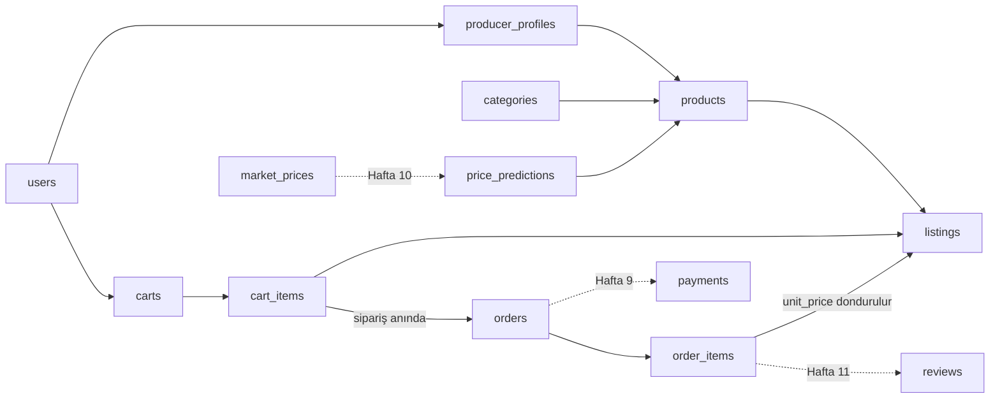

# Vize Hazırlığı: Git Etiketi, Demo Senaryosu ve Sözlü Sınav Yanıtları

## 1. Git etiketi (semantic versioning)

`v0.8.0-vize` biçimi şunları anlatır:

| Parça | Anlamı |
|---|---|
| `0` | Ana sürüm. 0 olması "henüz kararlı ilk sürüm (1.0.0) çıkmadı" demektir. |
| `8` | Ara sürüm. Yeni özellik eklendikçe artar; burada 8. haftaya denk gelir. |
| `0` | Yama. Yalnızca hata düzeltmesinde artar (ör. vize sonrası küçük düzeltme `v0.8.1`). |
| `-vize` | Ön-sürüm etiketi. Semver'de `0.8.0-vize`, `0.8.0`'dan önce sayılır. |

```bash
git status                                    # her şey commit edilmiş mi?
pytest -q                                     # etiketlemeden önce testler yeşil olmalı
git add .
git commit -m "Vize ara sürümü: entegrasyon düzeltmeleri, demo verisi ve entegrasyon testleri"
git tag -a v0.8.0-vize -m "Vize ara sürümü: kayıt→ürün→ilan→sepet→sipariş akışı, 95 test"
git push origin main                          # dalınızın adı master ise onu yazın
git push origin v0.8.0-vize                   # etiketler ayrıca gönderilir
git show v0.8.0-vize --stat                   # kontrol
```

Proje henüz Git deposu değilse önce:
`git init`, `git add .`, `git commit -m "İlk sürüm"`, `git branch -M main`,
`git remote add origin <depo-adresi>`, sonra yukarıdaki adımlar.

`-a` seçeneği "açıklamalı etiket" oluşturur: kimin, ne zaman, hangi mesajla etiketlediği saklanır.
Hafif etiketten (`git tag v0.8.0-vize`) daha uygundur.

## 2. Canlı demo senaryosu (≈ 2 dakika)

**Hazırlık (sunumdan önce):**
1. `flask seed-demo` çalıştırın.
2. İki tarayıcı penceresi açın: normal pencerede `ciftci@demo.com`, gizli pencerede `musteri@demo.com`. Parola: `Demo12345`.
3. `pytest -q` çıktısını bir terminalde hazır tutun.

| Süre | Ekran | Söylenecek / yapılacak |
|---|---|---|
| 0:00 | Ana sayfa | "Çiftçinin aracısız sattığı bir pazar yeri. Flask, katmanlı mimari, 14 tablo, 95 test." |
| 0:10 | **Üretici** paneli | İstatistik kartlarını gösterin (aktif ilan, ilgilenilecek sipariş). |
| 0:20 | Ürünlerim → bir ürünün **İlan aç** düğmesi | Miktarı depo stoğundan fazla girin → "en fazla … kg" uyarısı. "İlan, depodaki stoğu aşamaz." |
| 0:35 | **Müşteri** → Pazar | "domates" arayın → detay → 3 kg **Sepete ekle**. |
| 0:50 | Sepetim → Siparişi tamamla | Adres hesaptan otomatik gelir → **Siparişi onayla** → durum çizelgesi. |
| 1:05 | **Üretici** → Gelen Siparişler | Yeni sipariş görünür → **Ödemeyi onayla** → **Kargoya verildi**. |
| 1:25 | **Müşteri** → sipariş detayı | **Teslim aldım** → çizelge tamamlanır. "Birim fiyat sipariş anında donduruldu." |
| 1:40 | **Üretici** → İlanlarım | Kalan stoğun 3 kg azaldığını gösterin. |
| 1:50 | Terminal | `95 passed` çıktısı. "Bu akışın tamamı `test_integration.py` ile otomatik test ediliyor." |

**Yedek plan:** Canlı demoda bir şey ters giderse terminalde `pytest -v tests/test_integration.py` çalıştırıp
`test_full_marketplace_journey` testini adım adım açıklayın.

## 3. Sözlü sınav yanıtları

### S1. Şu ana kadarki mimariyi özetle.

Flask ile **uygulama fabrikası** (`create_app`) ve **dört katmanlı** mimari kullandım:

1. **Sunum katmanı:** `routes/` (7 Blueprint), `forms/` (Flask-WTF), `templates/` (Jinja2 + Bootstrap 5). Yalnızca isteği alır, formu doğrular, servisi çağırır, sonucu gösterir.
2. **İş mantığı katmanı:** `services/` (auth, producer, category, listing, cart, order). Tüm kurallar buradadır: stok negatif olamaz, aktif ilanlar depo stoğunu aşamaz, sipariş durum makinesi gibi.
3. **Veri erişim katmanı:** `repositories/`. Veri tabanına giden tek yerdir; sorgular ve atomik stok güncellemeleri buradadır.
4. **Veri katmanı:** `models/` içinde 14 SQLAlchemy modeli; şema değişiklikleri Flask-Migrate ile sürümlenir.

Katmanları kesen ortak parçalar:
- **Flask-Login:** oturum yönetimi.
- **CSRFProtect:** her POST isteğinde güvenlik anahtarı kontrolü.
- **`@role_required` dekoratörü:** rol tabanlı erişim.
- **Hata işleyicileri:** 403, 404, 413, 500 ve CSRF hataları için sayfalar.

**Örnek istek akışı (`POST /sepet/onay`):**
1. `cart_routes.checkout` isteği alır ve `CheckoutForm` ile adresi doğrular.
2. `order_service.place_order` çağrılır.
3. `OrderRepository` koşullu UPDATE ile stokları düşürür.
4. Sipariş ve kalemleri yazılır, sepet boşaltılır, tek bir `commit` yapılır.
5. Kullanıcı sipariş detayına yönlendirilir.

### S2. Hangi modül hangi veriyi nereden alıyor?

| Modül | Okuduğu veri | Yazdığı veri | Kaynak / bağlantı |
|---|---|---|---|
| Kimlik doğrulama | `users`, `roles` | `users` (+ `producer_profiles` veya `carts`) | Kayıt formu; her istekte oturum çerezindeki id → `user_loader` → `users` |
| Üretici profili | `producer_profiles`, `users` | Aynı tablolar | Profil formu |
| Ürün | `categories` (yönetici tanımlar), `products` | `products`, görsel dosyası diske | Ürün formu; görsel `static/uploads/products/` |
| İlan | `products` (stok sınırı için), `listings` | `listings` | Kural: aktif ilanların toplamı ≤ `products.stock_quantity` |
| Pazar | `listings` ⋈ `products` ⋈ `producer_profiles` ⋈ `categories` | — | Yalnızca satışta, tarihi geçerli, ürünü aktif ilanlar (SQL'de süzülür) |
| Sepet | `listings` (canlı fiyat ve stok) | `carts`, `cart_items` | Sepet stoğu düşürmez, yalnızca kontrol eder |
| Sipariş | `cart_items`, `listings` | `orders`, `order_items`; `listings` ve `products` stoğunu düşürür | Fiyat `order_items.unit_price` alanına dondurulur |
| Paneller | `orders`, `order_items`, `products`, `listings` | — | SQL `COUNT` / `SUM` sorguları |
| **Sonraki haftalar** | | | |
| Ödeme (H9) | `orders` | `payments`, `orders.status` | Ödeme sağlayıcısının sandbox API'si |
| Fiyat takibi (H9) | — | `market_prices` | Harici hal fiyatı API'si (yedek: sahte servis) |
| Yapay zekâ (H10) | `market_prices` | `price_predictions` | Trend modeli → üretici paneli |
| Değerlendirme (H11) | Teslim edilmiş `order_items` | `reviews`, `producer_profiles.reputation_score` | Yalnızca satın alınmış ürüne yorum |



### S3. En çok zorlandığın entegrasyon neydi, nasıl çözdün?

> İpucu: Kendi yaşadığınız örneği anlatmak en inandırıcısıdır. Aşağıdaki, projede gerçekten çözülen en zor sorundur.

**Sorun:** Hafta 6'da ürüne "depo stoğu" ekledim, Hafta 7'de ilana "satışa ayrılan stok" geldi. Sipariş verildiğinde
iki stoğun **birlikte, tutarlı ve eşzamanlı isteklere dayanıklı** düşmesi gerekiyordu. Üç alt problem vardı:

1. **Tutarlılık:** İlanlar toplamda depodakinden fazla satabilirdi.
   **Çözüm:** Aktif ilanların toplamı ürün stoğunu aşamaz kuralını `listing_service` içine koydum. Hafta 6'daki ürün düzenleme servisine de geri dönüp "stok, ilanlara ayrılan miktarın altına inemez" kontrolünü ekledim.
2. **Yarış durumu (race condition):** İki müşteri aynı anda son ürünü alırsa ikisi de "stok var" okuyabilirdi.
   **Çözüm:** Oku-hesapla-yaz yerine tek bir koşullu UPDATE kullandım:
   ```sql
   UPDATE ... SET stok = stok - q WHERE stok >= q
   ```
   `rowcount == 0` ise stok yetmemiştir.
3. **Yarım kalma:** İkinci kalemde stok yetmezse ilk kalemin stoğu düşmüş kalıyordu.
   **Çözüm:** Tüm adımları tek transaction'a aldım: herhangi bir hatada `rollback`, her şey başarılıysa tek `commit`. Ek olarak, toplu UPDATE sonrası oturumdaki nesneler eski değeri gösterdiği için `synchronize_session=False` kullandım ve `commit` sonrası nesnelerin veri tabanından yeniden okunmasına güvendim.

**Kanıt:**
- `test_failure_rolls_back_everything`: ikinci kalem başarısız olunca ilk kalemin stoğu geri gelir, sipariş oluşmaz, sepet aynen kalır.
- `test_stock_taken_by_someone_else_is_caught`: başka müşterinin aldığı stok yakalanır.

**Vize haftasındaki küçük bir entegrasyon hatası:** Sipariş saatleri 3 saat geri görünüyordu. Nedeni, SQLite'ın
saat dilimi bilgisini saklamaması ve okunan değerin "naive" gelmesiydi. Filtrede değeri önce UTC olarak işaretleyip
sonra UTC+3'e çevirdim ve bunun için bir test ekledim.

### S4. Yapay zekâdan aldığın bir kod parçasını satır satır açıkla.

`app/repositories/order_repository.py` → `decrease_listing_stock`:

```python
@staticmethod                                                                  # 1
def decrease_listing_stock(listing_id, quantity):                              # 2
    result = db.session.execute(                                               # 3
        update(Listing)                                                        # 4
        .where(Listing.id == listing_id,                                       # 5
               Listing.status == ListingStatus.ACTIVE,                         # 6
               Listing.stock_quantity >= quantity)                             # 7
        .values(stock_quantity=func.round(Listing.stock_quantity - quantity, 2))  # 8
        .execution_options(synchronize_session=False)                          # 9
    )
    return result.rowcount == 1                                                # 10
```

1. `@staticmethod`: metot nesne durumu (`self`) kullanmaz; `OrderRepository.decrease_listing_stock(...)` diye sınıf üzerinden çağrılır.
2. Parametreler: hangi ilan (`listing_id`) ve ne kadar düşülecek (`quantity`, `Decimal`).
3. `db.session.execute(...)`: oturumun açık transaction'ı içinde bir SQL ifadesi çalıştırır. Henüz `commit` yoktur; hata olursa `rollback` ile geri alınabilir.
4. `update(Listing)`: `UPDATE listings ...` ifadesini kurar. Nesneyi Python'a çekmeden doğrudan veri tabanında günceller.
5. `WHERE id = :listing_id`: yalnızca bu ilan.
6. `AND status = 'active'`: pasif veya tükenmiş ilan satılmasın.
7. `AND stock_quantity >= :quantity`: **asıl güvenlik satırı.** Stok yetmiyorsa koşul sağlanmaz ve hiçbir satır güncellenmez. Kontrol ve düşürme aynı SQL ifadesinde olduğu için arada başka bir isteğin araya girme şansı yoktur (atomiklik).
8. `SET stock_quantity = ROUND(stock_quantity - :quantity, 2)`: yeni değer veri tabanında, mevcut değerden hesaplanır. `ROUND`, SQLite'ın ondalıkları float tutmasından doğan `6.7999…` gibi kayan nokta artıklarını temizler; aksi halde sonraki `>=` karşılaştırmaları yanlış sonuç verebilirdi.
9. `synchronize_session=False`: SQLAlchemy'ye "oturumdaki Python nesnelerini güncellemeye çalışma" der. `commit` sonrası nesneler zaten veri tabanından yeniden okunur. (Kodda bu, `_NO_SYNC` sözlüğüyle verilir.)
10. `rowcount == 1`: güncellenen satır sayısı. 1 ise stok düşmüştür (`True`); 0 ise stok yetmemiş veya ilan satışta değildir (`False`). Çağıran `place_order`, `False` alınca `ServiceError` fırlatır ve `except` bloğu `rollback` yapar.

**Neden "oku → if → yaz" yazmadık?**
```python
if listing.stock_quantity >= q:
    listing.stock_quantity -= q
```
Bu kodda okuma ile yazma arasında başka bir istek aynı stoğu okuyabilir; iki satış birden geçer ve stok eksiye düşer.

### S5. Bir sonraki aşamanın planı nedir?

| Hafta | Plan | Teknik yaklaşım | Bitti sayılma ölçütü |
|---|---|---|---|
| 9 | Harici fiyat ve ödeme API'si | `integrations/` altında istemciler: `requests` ile zaman aşımı, hata yakalama; `USE_MOCK_APIS` ile sahte servise geçiş. Fiyatlar `market_prices` tablosuna günlük kaydedilir (`flask fetch-prices`). Ödeme sandbox'ı başarılı olunca sipariş otomatik `paid` olur; ödenmiş sipariş iptalinde iade çağrılır. | API kapalıyken de uygulama çalışır; ödeme akışı testleri |
| 10 | Yapay zekâ: trend tahmini ve satış zamanı önerisi | `market_prices` geçmişinden hareketli ortalama + doğrusal regresyon (scikit-learn) ile 7 günlük tahmin; eğim ve güven aralığına göre "şimdi sat / bekle" önerisi; sonuç `price_predictions` tablosuna | Üretici panelinde öneri kartı; MAE ile ölçülmüş doğruluk; veri azsa öneri verilmez |
| 11 | Değerlendirme ve itibar | Yalnızca teslim edilmiş kaleme tek yorum; Bayes ortalaması: `(C·m + Σpuan) / (C + n)`. Az yorumlu üretici tek 5 yıldızla zirveye çıkamaz | Pazar ve ilan detayında puan |
| 12 | Satış raporları | Üretici için dönem, ürün ve durum bazlı ciro; Chart.js grafikleri; CSV dışa aktarma | Rapor sayfası + testler |
| 13-15 | Kalite ve teslim | pytest-cov ile kapsam ≥ %80, README ve kullanıcı kılavuzu, final sunumu | `v1.0.0` etiketi |

**Riskler:** Gerçek hal fiyatı API'sine erişim olmayabilir (yedek: sahte veri üreticisi); az veriyle modelin yanılması (yedek: veri yetersizse öneri gösterilmez).
